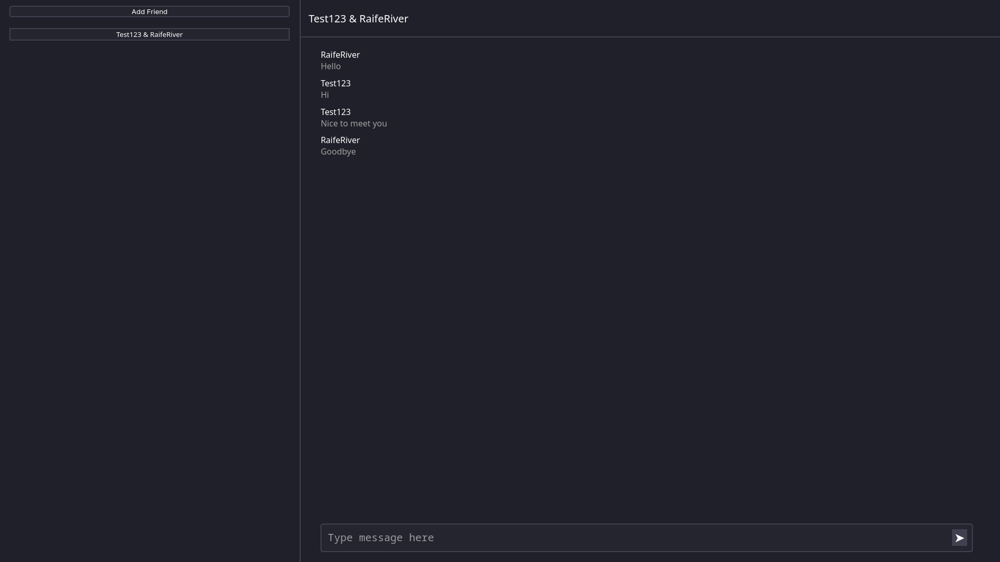

# Zormid

Zormid is a web-based chat app designed for self-hosting with low-spec servers.

It is designed for chatting to friends in real time over the internet.



## Features
 - Low server requirements
 - Free and open source
 - Either self-hosting or use our server

## Limitations
 - Requires linux server
 - Only supports web clients
 - No encryption

**NOTE: Zormid is currently WIP and these limitations will likely be addressed soon.**

## Hosting
It requires a linux server as it relies on POSIX features. The default port is `8080` however this can be changed in `data/zormid.conf`.

### Pre-built
Download the latest [release](https://github.com/RaifeRiver/zormid/releases) from GitHub and extract. Run `./zormid` in the `bin` directory.

### Manual compilation
Make sure you have gcc and CMake installed. Then run the following commands:
```Bash
git clone -b production https://github.com/RaifeRiver/Zormid.git
cd Zormid
mkdir cmake-build-release
cd cmake-build-release
cmake .. -DCMAKE_BUILD_TYPE=Release
cmake --build . --config Release -j $(nproc)
```
The executable will be located at `cmake-build-release/zormid`. Run it from the `cmake-build-release` directory.

## Why did I make this?
I wanted to learn how online chat apps work and make something I could actually use (if I can convince anyone else to use it). Also, it is incredibly lightweight with the custom web server written in C++ using just 4MB of RAM thanks to using raw posix sockets instead of large bloated libraries.